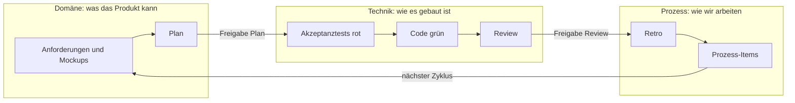

# Arbiter im Überblick

Für Menschen: wie das Agentensystem Arbiter baut. Was Arbiter können soll, steht im
[Ziel](../domaene/ziel.md); wie gearbeitet wird, im [Ablauf](../prozess/ablauf.md).

## Drei Perspektiven, ein Zyklus



In jeder Phase arbeitet eine Perspektive, die anderen kritisieren. Der Stakeholder gibt Plan,
Review und Retro in [`handoff/`](../handoff/) frei; Diskussionen laufen als Anliegen.

## Rollen

Rolle | Modell | Aufgabe
---|---|---
[Koordinator](../.claude/agents/koordinator.md) | opus | Hauptkontakt des Stakeholders. Hält die Produktentwicklung am Laufen: leitet vom Ziel den nächsten Schritt ab, beauftragt Rollen, committet.
[Planer](../.claude/agents/planer.md) | opus | Domäne, ausführend. Leitet aus dem Ziel Etappen ab, schneidet Items und schreibt den Plan des Zyklus mit Empfehlung.
[Anforderungsautor](../.claude/agents/anforderungsautor.md) | opus | Domäne, ausführend. Schreibt Anforderungen mit prüfbaren Kriterien und pflegt das Glossar. Erfindet keine Regeln.
[UX](../.claude/agents/ux.md) | sonnet | Domäne, ausführend. Schreibt einbaufähige Mockups zu Anforderungen mit Oberfläche, bevor der Plan freigegeben wird.
[Fachkritiker](../.claude/agents/fachkritiker.md) | opus | Domäne, prüfend. Prüft, ob Akzeptanztests ihr Kriterium treffen, und nimmt das Gebaute gegen Kriterien, Etappe und Ziel ab.
[Architekt](../.claude/agents/architekt.md) | opus | Technik, ausführend. Verantwortet die Architektur; kritisiert jedes Artefakt, vor allem Anforderungen auf Prüfbarkeit, Kosten und Schnitt.
[Testautor](../.claude/agents/testautor.md) | sonnet | Technik, ausführend. Schreibt vor dem Code rote Akzeptanztests, je Kriterium der Items mindestens einen. Erfindet keine Fälle.
[Implementierer](../.claude/agents/implementierer.md) | sonnet | Technik, ausführend. Macht rote Akzeptanztests grün, mit Unit-Tests, wo die Logik nicht trivial ist. Ändert keine Akzeptanztests.
[Reviewer](../.claude/agents/reviewer.md) | opus | Technik, prüfend. Prüft das Inkrement gegen die DoD, auf Korrektheit, Wiederverwendung, Einfachheit und Flughöhe; schreibt das Review.
[Organisationsentwickler](../.claude/agents/organisationsentwickler.md) | opus | Prozess, ausführend. Gestaltet Rollen, Skills, Abläufe und die Retro. Ändert die Organisation nur aus einem Befund.
[Regelumsetzer](../.claude/agents/regelumsetzer.md) | sonnet | Prozess, ausführend. Setzt Regeln als Mechanismen um (Hook, Prüfskript, Linter), jeweils mit Scheiter-Test.
[Moderator](../.claude/agents/moderator.md) | sonnet | Prozess, prüfend. Sortiert vor jeder Freigabe die offenen Anliegen: wer dran ist, was blockiert, was zusammengehört oder schließen kann.

## Ordner

```
Arbiter/
├── CLAUDE.md              Ziel, Perspektiven, Prämissen
├── .claude/               agents/ · skills/ · rules/ · settings.json
├── domaene/               ziel.md · etappen/ · anforderungen/ · items/ · glossar.md
│                          mockups/ · daten/ · referenz/
├── technik/               architektur.md · architektur/ · arbiter/ · frontend/
│                          tests/{akzeptanz,einheit}/
├── prozess/               praemissen/ · ablauf.md · regeln.md · kennzahlen.md
│                          backlog.md · pruefungen/ · dashboard/
├── handoff/               plan.md · review.md · retro.md · moderation.md · anliegen/
└── doku/                  dieser Überblick
```
